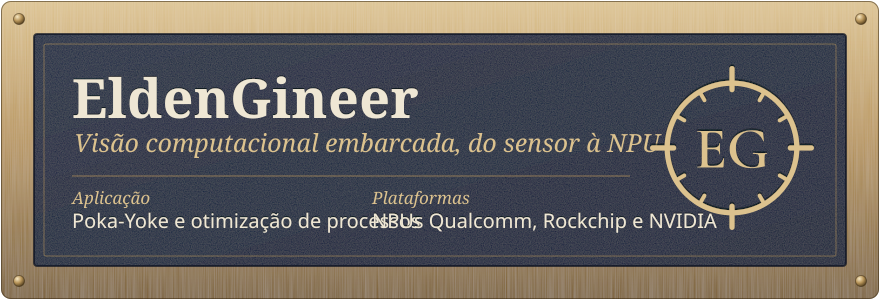
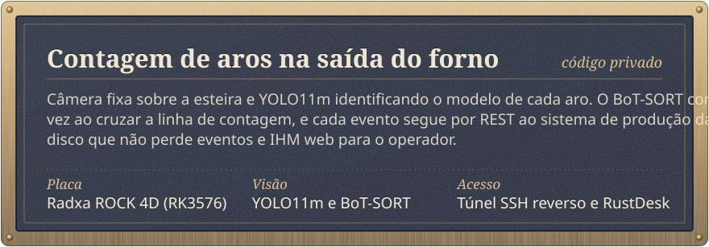
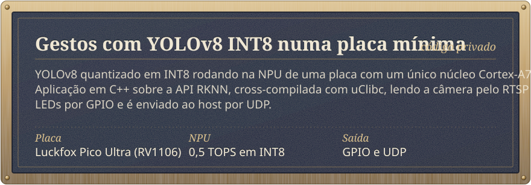

  

  

---

Trabalho dentro de fábricas: visito as linhas, entendo o processo e desenho soluções de **visão computacional** para
otimização de processos e **Poka-Yoke**. Desenvolvo o sistema completo, da coleta e tratamento dos dados ao treino do
modelo e ao **embarque em SBCs**, e valido em hardware real qual placa atende cada aplicação.

---

## 🧠 O que eu faço

**Sistemas de visão de ponta a ponta**
- Coleta de dados na linha, tratamento e anotação de datasets (**Roboflow**, **CVAT**), treino e avaliação de modelos.
- Diferentes arquiteturas **YOLO** (v5, v8, 11) para detecção e segmentação.
- **Rastreamento de objetos** (BoT-SORT) e lógica de contagem por linha virtual com votação de classe ao longo do trajeto.
- **Processamento digital de imagens** clássico combinado com deep learning: o modelo localiza, o PDI inspeciona ROIs em alta resolução.

**Embarque e validação de SBCs**
- Avalio placas para cada aplicação: desempenho da NPU, operadores suportados, limites de memória.
- Estudo o toolchain de cada SoC: **Qualcomm QAIRT/QNN**, **Rockchip RKNN**, **NVIDIA CUDA** e o SDK de NPU de cada fabricante.
- Conversão e quantização INT8 (`.pt → ONNX → formato nativo da NPU`) com calibração no domínio.
- Inferência em **C/C++** pela API nativa (zero-copy, V4L2) e benchmarks na placa.

**Software de produção para chão de fábrica**
- Captura e inferência em threads separadas, buffer local resistente a queda de energia e reenvio automático.
- Integração com sistemas da fábrica via **REST**, com simulador em Docker para testar sem o sistema real.
- **IHMs web** para o operador (**Flask** + Jinja2, HTML, CSS e JavaScript): vídeo ao vivo com anotações, contagem por modelo, fila de envio, histórico e logs,
  com atualização automática e colunas configuráveis.
- Testes automatizados que rodam sem precisar do modelo.
- Ambientes reprodutíveis com **Docker** e controle fino de câmeras com **V4L2**.

**Acesso remoto e operação de placas em campo**
- Configuração de SBCs para acesso e manutenção remotos depois de instaladas no cliente.
- **Redirecionamento de portas via SSH** (`ssh -L`) para abrir no meu navegador a IHM de placas sem monitor.
- **Túneis SSH reversos** até um servidor com **domínio público**, para alcançar placas atrás de NAT sem abrir portas
  nem precisar de acesso ao roteador do local.
- **RustDesk** como segundo caminho de acesso, para quando o túnel cai.

---

## 🏭 Experiência

  

  

---

## 🔧 Projeto público

### [sdkEldenGinner](https://github.com/EldenGineer/sdkEldenGinner) — gerenciador de câmeras V4L2
Ferramenta (GUI em PySide6 + CLI) para capturar datasets com controle total da câmera: modos e controles lidos do
driver, verificação do modo negociado, fotos com metadados em JSON, vídeo H.264/NVENC via ffmpeg com duração real,
modo rajada e navegação completa por teclado. Instalador idempotente e suíte de testes sem hardware.

`Python` `PySide6` `V4L2` `OpenCV` `ffmpeg` `pytest`

---

## 🛠️ Stack

| Área | Ferramentas |
|---|---|
| **Linguagens** | Python · C · C++ |
| **Visão / IA** | Ultralytics YOLO · PyTorch · OpenCV · ONNX · BoT-SORT |
| **Dados** | Roboflow · CVAT |
| **Borda** | Qualcomm QAIRT/QNN · Rockchip RKNN · NVIDIA CUDA · V4L2 · Linux embarcado |
| **SBCs** | Jetson Orin Nano · Radxa Dragon Q6A (QCS6490) · Radxa ROCK 4D (RK3576) · Luckfox Pico Ultra (RV1106) · Orange Pi 4 Pro (A733) |
| **Web / IHM** | Flask · Jinja2 · HTML · CSS · JavaScript · PySide6 |
| **Ferramentas** | Docker · Git · SSH · RustDesk · ffmpeg |

---

📊 Atividade no GitHub

 

<picture>
  <source media="(prefers-color-scheme: dark)" srcset="https://raw.githubusercontent.com/EldenGineer/EldenGineer/output/github-snake-dark.svg" />
  <source media="(prefers-color-scheme: light)" srcset="https://raw.githubusercontent.com/EldenGineer/EldenGineer/output/github-snake.svg" />
  
</picture>

